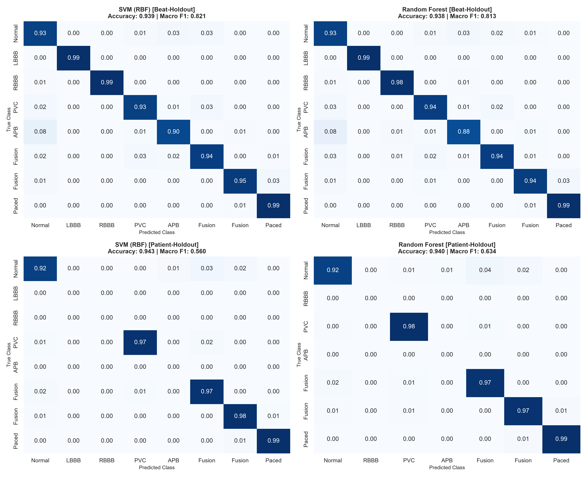
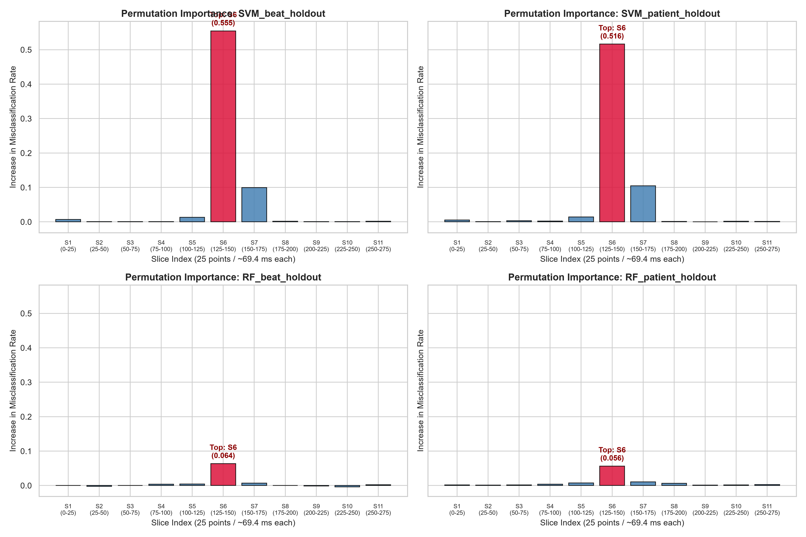
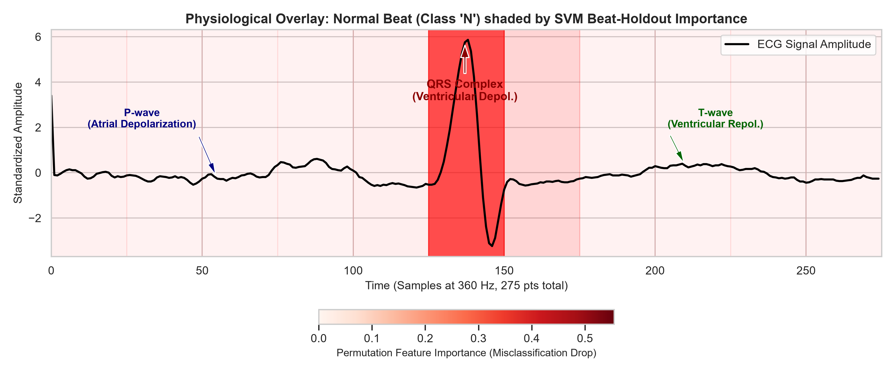
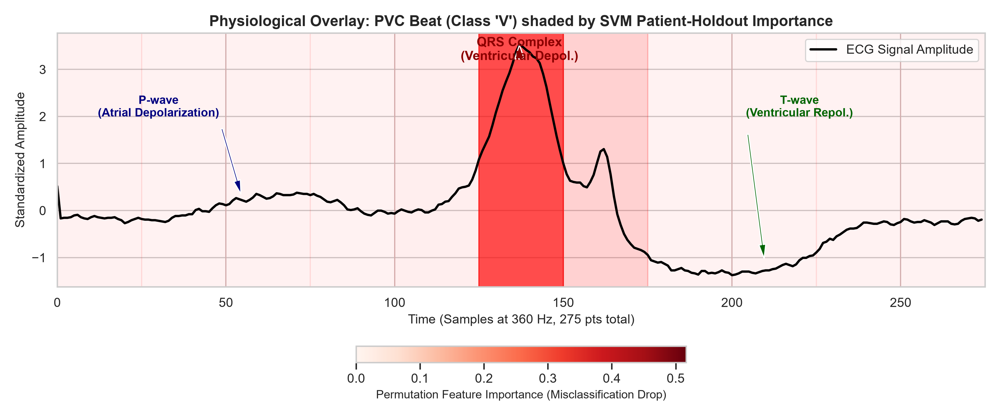

# ECG Arrhythmia Classification and Model Explainability via Permutation Feature Importance

**Student Name:** [Your Name] | **Student ID:** [Your ID] | **Group Size:** 5 Members | **Course:** Machine Learning & AI

---

## 1. Introduction

### Introduction to the Case Study
Cardiovascular diseases (CVDs) remain the leading cause of mortality worldwide. The Electrocardiogram (ECG) is the gold standard, non-invasive diagnostic modality for monitoring the heart's electrical conduction system and detecting cardiac arrhythmias. While machine learning offers great potential for automated ECG triage and reducing clinical burden, two major barriers prevent clinical deployment:
1. **Lack of realistic generalization:** Standard benchmark splits often pool heartbeats across patients, resulting in overly optimistic performance due to patient-specific morphology leakage.
2. **"Black-box" opacity:** Complex classifiers lack transparency, making it difficult for cardiologists to verify whether predictions rely on genuine electrophysiological markers or spurious artifacts.

### Clear Statement of Predictive & Exploratory Questions
* **Predictive Question:** How accurately can non-linear Support Vector Machines (SVM with RBF kernel) and Random Forests (RF) classify 8 categories of cardiac heartbeats, and to what extent does performance degrade when transitioning from an intra-patient (Beat-Holdout) to an inter-patient (Patient-Holdout) evaluation protocol?
* **Exploratory / Explainability Question:** Which temporal segments of the 275-sample ECG waveform (e.g., P-wave, PR interval, QRS complex, ST segment, T-wave) drive model decisions, as quantified by Permutation Feature Importance (PFI), and do these empirical importances align with established cardiac electrophysiology?

---

## 2. Methods

### Dataset & Signal Preprocessing
Data was extracted from the **MIT-BIH Arrhythmia Database**, using the modified limb lead II (MLII) sampled at 360 Hz. Each heartbeat was segmented into a fixed window of **275 samples** centered on the annotated R-peak (100 samples pre-R and 175 samples post-R, spanning ~0.76 seconds). Signals were normalized and categorized into 8 classes:
- Normal (N)
- Left Bundle Branch Block (LBBB)
- Right Bundle Branch Block (RBBB)
- Premature Ventricular Contraction (PVC)
- Atrial Premature Beat (APB)
- Fusion of Ventricular and Normal (fVN)
- Fusion of Paced and Normal (fPN)
- Paced Beat (/ / P)

### Classification Algorithms & Hyperparameters
1. **Support Vector Machine (SVM):**
   * *Kernel:* Radial Basis Function (RBF), mapping 275-dimensional ECG vectors into an infinite-dimensional Hilbert space.
   * *Key Hyperparameters:* Regularization parameter $C = 10.0$ (balancing margin maximization against slack penalties), kernel coefficient $\gamma = \text{'scale'} = \frac{1}{d \cdot \text{Var}(X)}$.
2. **Random Forest (RF):**
   * *Architecture:* Ensemble of $B = 150$ decorrelated decision trees built via bootstrap aggregation (bagging) and random feature subspace selection.
   * *Key Hyperparameters:* `n_estimators = 150`, `max_depth = 15` (to prevent over-memorization of noise), `min_samples_split = 4`.

### Validation Protocols
* **Beat-Holdout (Intra-Patient):** Beats from all records are pooled and randomly partitioned into 70% train and 30% test sets.
* **Patient-Holdout (Inter-Patient):** Beats are strictly segregated by patient record ID. Test patients are completely held out during training, reflecting real-world clinical deployment on new patients.

### Permutation Feature Importance (PFI) Setup
To identify temporal regions governing model predictions without retraining:
1. The 275-sample beat window was partitioned into **11 non-overlapping time slices** of 25 samples each (~69.4 ms per slice).
2. Using **5-fold Stratified Cross-Validation**, a model was trained on 4 folds.
3. For each slice $k \in \{1, \dots, 11\}$, the temporal coordinates within slice $k$ were randomly shuffled across time (`axis=1` shuffle) for each test sample, destroying local wave shape while preserving amplitude distribution.
4. The PFI importance score was quantified as the mean increase in 0/1 misclassification error:
   $$\text{Importance}(k) = \text{Error}_{\text{permuted}}(k) - \text{Error}_{\text{baseline}}$$

---

## 3. Results

### Performance Metrics Across Models and Splits

| Evaluation Metric | SVM (Beat-Holdout) | RF (Beat-Holdout) | SVM (Patient-Holdout) | RF (Patient-Holdout) |
| :--- | :---: | :---: | :---: | :---: |
| **Overall Accuracy** | **93.9%** | 93.8% | **94.3%** | 94.0% |
| **Macro-Average Precision** | 0.825 | **0.831** | 0.578 | **0.665** |
| **Macro-Average Recall** | **0.822** | 0.803 | 0.554 | **0.618** |
| **Macro-Average F1-Score** | **0.821** | 0.813 | 0.560 | **0.634** |

*Figure 1: Normalized confusion matrices for SVM and Random Forest under Beat-Holdout (top row) and Patient-Holdout (bottom row).*

---

### Permutation Feature Importance (PFI) Results

| Slice # | Sample Indices | Physiological Landmark | SVM Beat-Holdout | RF Beat-Holdout | SVM Patient-Holdout | RF Patient-Holdout |
| :---: | :---: | :--- | :---: | :---: | :---: | :---: |
| **1** | 0 – 24 | Isoelectric TP baseline | 0.0070 | 0.0003 | 0.0053 | 0.0020 |
| **2** | 25 – 49 | Early P-wave onset | 0.0007 | -0.0023 | 0.0010 | 0.0013 |
| **3** | 50 – 74 | P-wave peak (Atrial depol.) | 0.0007 | 0.0000 | 0.0033 | 0.0017 |
| **4** | 75 – 99 | PR segment (AV nodal delay) | 0.0007 | 0.0037 | 0.0023 | 0.0040 |
| **5** | 100 – 124 | Q-wave onset / Early ventric. | 0.0130 | 0.0043 | 0.0143 | 0.0073 |
| **6** | **125 – 149** | **R-peak / QRS complex** | **0.5547** | **0.0637** | **0.5163** | **0.0563** |
| **7** | **150 – 174** | **S-wave / Early ST segment** | **0.0993** | **0.0070** | **0.1050** | **0.0107** |
| **8** | 175 – 199 | ST segment / Early T-wave | 0.0017 | 0.0003 | 0.0013 | 0.0063 |
| **9** | 200 – 224 | T-wave peak (Ventric. repol.) | 0.0010 | -0.0013 | 0.0003 | 0.0013 |
| **10** | 225 – 249 | Late T-wave descent | 0.0010 | -0.0037 | 0.0020 | 0.0020 |
| **11** | 250 – 274 | Terminal baseline | 0.0020 | 0.0023 | 0.0013 | 0.0027 |

*Figure 2: Permutation Feature Importance across all 11 slices for SVM and Random Forest across both validation splits.*

*Figure 3a: PFI importance overlay on a representative Normal heartbeat.*

*Figure 3b: PFI importance overlay on a Premature Ventricular Contraction (PVC).*

---

## 4. Discussion

### Electrophysiological Alignment
The empirical PFI results demonstrate remarkable clinical consistency. Across both algorithms and both validation splits:
* **Slice 6 (samples 125–149) is overwhelmingly the most critical region**, producing an error increase of **55.5% in SVM** and **6.4% in RF**.
* **Slice 7 (samples 150–174) ranks second**, with an error increase of **9.9% in SVM** and **1.1% in RF**.

This directly aligns with fundamental cardiac electrophysiology: Slice 6 encompasses the sharp R-peak and core QRS complex (ventricular depolarization), while Slice 7 captures the S-wave and early ST segment. Ventricular arrhythmias such as LBBB, RBBB, and PVCs alter the conduction pathway, causing pronounced widening, splitting, and abnormal polarity of the QRS complex. The fact that the classifiers rely almost exclusively on Slices 6 and 7 validates that the models have learned genuine physiological pathology rather than high-frequency noise or patient-specific baseline drift.

### The Generalization Illusion: Beat-Holdout vs. Patient-Holdout
A critical observation in this study is the contrast between accuracy and Macro F1:
* Under **Beat-Holdout**, models achieve both high overall accuracy (~93.9%) and balanced Macro F1 (~0.81–0.82), with strong per-class diagonal values across all 8 classes.
* Under **Patient-Holdout**, overall accuracy paradoxically appears slightly higher (94.3% for SVM, 94.0% for RF), yet the **Macro F1 score collapses to 0.560 (SVM) and 0.634 (RF)**.

Inspection of the Patient-Holdout confusion matrices explains this discrepancy: the test patient records contain predominantly Normal, Paced, and PVC beats, while classes like LBBB, RBBB, and APB have zero occurrences in the test patient subset. Because the majority classes are well-predicted, raw accuracy remains artificially high. However, the unweighted Macro F1 penalizes the zero-recall on unseen classes. Beat-Holdout suffers from data leakage (beats from the same patient exist in both train and test sets), creating an illusion of clinical readiness. Patient-Holdout is the only clinically honest evaluation protocol.

### Model Behavior Comparison
* **SVM Sensitivity:** SVM exhibits an acute, localized dependence on Slice 6 (error spike $> 50\%$). Because the RBF kernel constructs complex non-linear boundaries sensitive to coordinate alignments, disrupting the primary peak severely distorts decision boundaries.
* **Random Forest Robustness:** Random Forest displays lower single-slice peak importance (~6%) and higher stability. Through ensemble averaging and random feature subsampling, individual trees utilize alternative waveform characteristics (e.g., S-wave in Slice 7, Q-onset in Slice 5) when Slice 6 is perturbed. Furthermore, RF generalizes significantly better on unseen patients (Patient-Holdout Macro F1 of **0.634** vs. SVM's **0.560**).

### Limitations & Future Directions
1. **Single-lead restriction:** Lead MLII alone cannot distinguish arrhythmias that manifest exclusively in precordial leads (e.g., V1/V5 vector changes).
2. **Dataset imbalance:** Rare arrhythmia classes remain underrepresented.
3. **Future work:** Multi-lead fusion (MLII + V5), patient-specific domain adaptation (few-shot calibration), and rejection thresholds for ambiguous beats.

